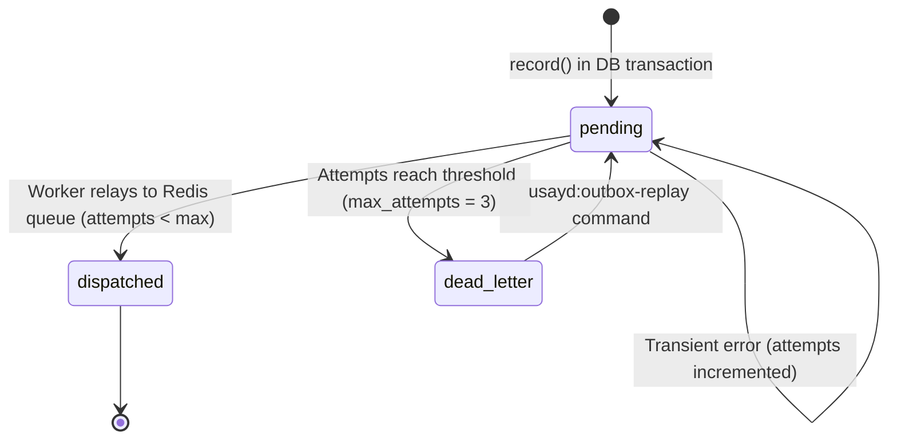

# Architecture Decision & Specification — Transactional Outbox for Notifications (USYD-T0031)

**Status:** APPROVED  
**Author:** Principal Full Stack Architect & Autonomous Delivery Operator  
**Date:** November 2026  
**Context:** Usayd Academy Foundation & Sprint S01  
**Target Repository:** `usayd-api`  

---

## 1. Architectural Context & Problem Statement

In an enterprise e-learning and educational platform, operations such as student enrollment, payment completion, session reservations, and recitation evaluations trigger asynchronous external side-effects (push notifications, SMS, email, and live WebSocket broadcasts).

A naive architecture invokes queue dispatchers or notification services directly from controllers or models within the same HTTP lifecycle. This introduces the classic **Dual-Write Problem**:
- If the database transaction commits but the queue dispatch fails (network partition, broker timeout), the notification is lost forever.
- If the queue message is dispatched first but the database transaction rolls back, the user receives an alert for a state mutation that never persisted.

## 2. The Transactional Outbox Pattern

To achieve **at-least-once delivery** with absolute transaction-bound consistency, Usayd Academy employs the **Transactional Outbox Pattern**:

1. **Commit-Bound Persistence:**  
   Every domain event or notification intent is written to the `outbox_messages` table within the **same atomic database transaction** that mutates the domain entities (e.g., `users`, `learning_plans`). If the transaction fails, the outbox message is rolled back with it.

2. **Decoupled Polling & Relaying:**  
   A dedicated background worker (`php artisan usayd:outbox-worker`) polls pending messages and relays them to high-throughput Redis queues (specifically the `notifications` partition).

3. **Concurrency-Safe Polling via MySQL 8.4 `SKIP LOCKED`:**  
   To enable seamless horizontal worker scaling without row collision or deadlocks, the worker queries eligible records using `SELECT ... FOR UPDATE SKIP LOCKED`. This guarantees disjoint batch acquisition across concurrent worker instances.

---

## 3. Database Schema Foundations

The `outbox_messages` table is backed by **MySQL 8.4 LTS InnoDB** (`utf8mb4_unicode_ci`):

```sql
CREATE TABLE `outbox_messages` (
    `id` char(36) NOT NULL,
    `aggregate_type` varchar(100) NOT NULL,
    `aggregate_id` varchar(100) NOT NULL,
    `event_type` varchar(150) NOT NULL,
    `payload` json NOT NULL,
    `headers` json DEFAULT NULL,
    `status` varchar(30) NOT NULL DEFAULT 'pending',
    `attempts` smallint unsigned NOT NULL DEFAULT '0',
    `error_message` text DEFAULT NULL,
    `scheduled_at` timestamp NULL DEFAULT NULL,
    `processed_at` timestamp NULL DEFAULT NULL,
    `created_at` timestamp NULL DEFAULT NULL,
    `updated_at` timestamp NULL DEFAULT NULL,
    PRIMARY KEY (`id`),
    KEY `outbox_messages_status_scheduled_at_index` (`status`,`scheduled_at`),
    KEY `outbox_messages_aggregate_type_aggregate_id_index` (`aggregate_type`,`aggregate_id`)
) ENGINE=InnoDB DEFAULT CHARSET=utf8mb4 COLLATE=utf8mb4_unicode_ci;
```

---

## 4. State Machine & Lifecycle Transitions

An outbox message moves through explicit deterministic states:



### Lifecycle Rules:
- **`pending`**: Eligible for polling once `scheduled_at IS NULL OR scheduled_at <= NOW()`.
- **`dispatched`**: Relayed to Redis queue. `processed_at` is stamped; `error_message` cleared.
- **`dead_letter`**: Retries exhausted ($attempts \ge maxAttempts$, default 3). Emits an append-only `AuditEvent` with subject `outbox_dead_letter`.
- **Replay**: `resetForReplay()` resets `attempts` to 0, clears errors and timestamps, and returns status to `pending`.

---

## 5. Idempotency & Queue Deduplication

To prevent duplicate outbox messages caused by client retries or network replays:
- Publishers can supply an `idempotency_key` inside `headers`.
- `TransactionalOutboxService::record` validates whether an active outbox record with matching `(aggregate_type, aggregate_id, event_type, headers->idempotency_key)` exists before creating a new row.
- Downstream queue jobs (`DispatchOutboxNotificationJob`) carry this key so consumers can safely enforce deduplication.

---

## 6. Console Commands & Operational Usage

### Outbox Poller Worker
```bash
# Continuous daemon polling
php artisan usayd:outbox-worker --queue=notifications --limit=50 --sleep=3

# Single batch execution (cron/test)
php artisan usayd:outbox-worker --once --limit=50
```

### Dead-Letter Replay Tool
```bash
# Replay specific message
php artisan usayd:outbox-replay 018f3a2b-92f7-7b89-a2e1-456789abcdef

# Replay all dead-lettered records
php artisan usayd:outbox-replay --all-dead-letter
```

---

## 7. Security, Privacy & Minors Considerations

- **No Plain Secrets:** Auth tokens, user plaintext passwords, or raw billing numbers MUST NEVER be placed in `payload` or `headers`.
- **Traceability:** Every outbox record includes `headers.trace_id` for end-to-end distributed tracing from HTTP request to notification receipt.
- **COPPA & Minor Protection (O-04):** Notification payloads for minor students omit sensitive identifiers and contact details, emitting generic notification tokens to parent/guardian devices.
